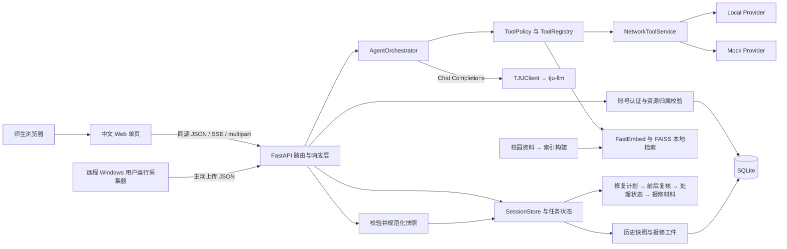
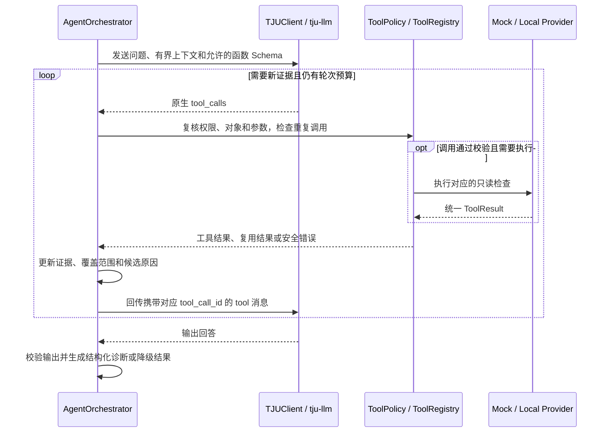
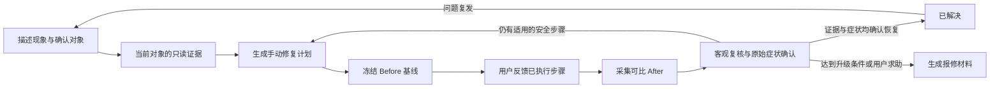

# TJU NetPilot 技术设计

本文基于仓库当前实现，说明校园网络问题如何从自然语言描述进入诊断、客户端取证、手动修复、复核和报修交接。运行与演示入口见 [README.md](README.md)。

## 1. 设计目标与架构取舍

系统面向师生自助初诊与人工分诊。诊断回答需要说明观察对象、证据、覆盖范围和下一步。校园知识问答使用可引用的资料，人工交接材料基于已记录的检查与处理结果生成。所有网络检测能力保持只读。

**单 Agent + Tools。** 主要任务在一个会话内依次完成意图判定、选择证据、分析和回答。`AgentOrchestrator` 负责这条有界流程，`ToolPolicy`、Pydantic 校验和 `ToolRegistry` 负责执行约束。修复、复核和处理状态由确定性代码维护，模型主要承担工具选择和自然语言组织。这样的分工让检测范围、失败原因和会话状态可以单独测试。

**编排采用普通 Python。** 当前流程由一个会话负责人协调，独立自治角色会增加模型调用、权限分配和状态同步。会话阶段和业务状态机已有明确边界，因此当前依赖只需要进程内编排和 SQLite。若未来出现跨权限域审批、后台长任务恢复或真正独立的数据源协作，再评估图式工作流或多 Agent。

## 2. 技术架构

| 层 | 实现位置 | 职责 |
| --- | --- | --- |
| Web | [`web/`](web/)，其中 `app.js` 管理请求，`student-ui.js` 管理学生界面，`client-check.js` 管理检查向导 | 原生 HTML、CSS、JavaScript；主界面显示对话与处理状态，按需展开诊断详情。Marked + DOMPurify 在本地渲染助手 Markdown，用户和错误文本按纯文本呈现。 |
| 应用与接口 | [`main.py`](src/netpilot/main.py)、[`api/`](src/netpilot/api/)、[`models/schemas.py`](src/netpilot/models/schemas.py) | FastAPI + Pydantic；组装依赖，挂载静态页面，统一身份检查、请求校验、返回结构与 SSE。 |
| 编排与证据 | [`agent/`](src/netpilot/agent/)、[`conversation_context/`](src/netpilot/conversation_context/)、[`diagnostic_target.py`](src/netpilot/diagnostic_target.py) | 意图分类、环境与对象管理、证据选择、Function Calling、覆盖判断、诊断与过程记录。 |
| 模型、工具与知识 | [`llm/`](src/netpilot/llm/)、[`tools/`](src/netpilot/tools/)、[`rag/`](src/netpilot/rag/) | OpenAI 兼容 SDK 调用 `tju-llm`；跨平台只读网络探测；FastEmbed / FAISS 本地向量检索。 |
| 处理流程 | [`client_snapshot/`](src/netpilot/client_snapshot/)、[`remediation/`](src/netpilot/remediation/)、[`verification/`](src/netpilot/verification/)、[`resolution/`](src/netpilot/resolution/)、[`escalation/`](src/netpilot/escalation/) | 客户端采集导入、低风险计划、修复前后比较、状态迁移与材料构建。 |
| 认证、存储和隐私 | [`auth/`](src/netpilot/auth/)、[`history.py`](src/netpilot/history.py)、[`reports.py`](src/netpilot/reports.py)、[`privacy/`](src/netpilot/privacy/) | Cookie 认证、账号与会话归属、SQLite 历史、报告导出及各数据边界的脱敏。 |

应用由 `create_app()` 创建 provider、模型客户端、检索器、注册表、Agent 和会话存储。`.env.example` 记录可调整的运行参数。知识索引、历史库和模型配置就绪情况由 `/api/health` 分别报告。

## 3. 对话诊断流程

### 3.1 意图、环境和可观测性

1. 客户端登录后创建会话，携带 `session_id` 发送消息。路由校验归属和会话占用情况，在一个活动轮次内处理输入、环境更新和任务状态。
2. 编排器识别实时诊断、补充环境、知识咨询、分析已有证据、历史分析、生成报告等意图，选择 `ResponseMode`。条件不足时提出结构化澄清问题。`EnvironmentProfile` 保存操作系统、接入方式、VPN / 代理、影响范围等字段，并保留字段来源和置信度。用户明确提供的信息优先于快照与浏览器推断；这些环境信息用于选路径。
3. `DiagnosticTarget` 记录对象、与服务进程的关系、执行上下文和 `target_version`。普通 Local Web 会话默认以浏览器设备为远程客户端；选择“NetPilot 服务主机”后才按主机范围发起检测。普通 Mock 会话使用模拟终端。服务端根据对象及 Provider 计算可用能力。
4. `DiagnosticReadiness` 决定直接回答知识问题、补充必要环境、请求客户端证据、复用已有结果或运行允许的诊断。工具授权由 `ToolPolicy` 和对象能力共同决定。远程设备的系统级证据来自其上传快照，缺少证据时只给受限建议。
5. `AgentOrchestrator` 构造有界上下文。任务和对象匹配的观测可跨轮复用；环境发生有效切换、对象改变或故障复发时，推进相应版本并使旧结论或步骤退出当前判断。历史记录仍可回看。

### 3.2 原生 Function Calling 与诊断停止

- **调用边界。** `ToolRegistry` 将注册项导出为 `type=function` Schema。编排器过滤模型可见工具，并在执行前再次核验策略、作用范围与参数。参数须为合法 JSON 对象，满足相应 Pydantic Schema，工具结果以相同 `tool_call_id` 回填；自然语言中的命令文本保持为文本。
- **证据判断。** `ToolResult.success` 表示检查是否成功执行。`resolved=false`、`connected=false` 等可成为异常观测。超时、缺少命令、权限阻断和参考资料分别按对应状态呈现。`DiagnosticCoverage`、候选原因和 `EvidenceSufficiency` 共同决定能否停止。完整网页故障通常需要网络配置、DNS、公网 IP 连通性和 TCP / HTTP 应用层覆盖；用户明确点名的单项检查按该检查的范围作答。
- **轮次与回退。** 单轮模型响应可包含多个调用。规范化的工具签名、对象版本和任务版本用于去重。默认最多 6 个工具轮次，覆盖充分、完成指定检查、达到上限、重复无法推进或模型异常时结束。已有证据可用于确定性降级，并明确未覆盖的检查项。
- **解释与展示。** `diagnosis` 返回摘要、主要问题、置信度、证据、建议和限制；`tool_calls` 保留执行记录；`reasoning_trace` 来自结构化意图、证据、候选原因和停止条件，默认生成过程摘要且无需额外模型调用。前端分别呈现诊断结论、证据和执行记录。

### 3.3 工具契约与 Provider

六个网络工具通过 `NetworkToolService` 共用 `NetworkProvider` 接口和 `ToolResult` 封装。工具结果含 `success`、`tool`、`summary`、`data`、`error` 和 `duration_ms`。`knowledge_search` 按索引可用性注册，属于不依赖网络诊断对象的资料检索。

| 工具 | 主要参数 | 输出用途 |
| --- | --- | --- |
| `get_network_info` | 无 | 网卡、IP、默认网关及 DNS 配置概览。 |
| `ping_host` | `host`、`count` | 可达性、丢包率和往返延迟。 |
| `dns_lookup` | `domain` | 是否解析成功、地址列表。 |
| `tcp_check` | `host`、`port`、`timeout` | 指定端口连接状态及失败原因。 |
| `http_check` | `url` | HTTP 状态、耗时、重定向及失败原因。 |
| `traceroute` | `host`、`max_hops` | 路径跳点、超时及是否到达目标。 |
| `knowledge_search` | `query` | 相关文本片段和来源元数据。 |

**Mock Provider** 使用内置或受开关保护的自定义场景，离线返回可复现工具结果。`MOCK_SCENARIO` 是普通 Mock 实例的共享状态；切换会使该实例的普通运行时会话失效。**Local Provider** 使用固定系统命令、系统与 Python 网络接口执行有界检查，支持 Windows、Linux、macOS，观测范围是 NetPilot 进程所在主机及该主机到目标的路径。两者以相同结构返回结果，证据携带实际执行范围。

## 4. 校园知识问答

1. **离线建库。** `scripts/build_knowledge_index.py` 读取 `knowledge/raw/` 中带 YAML front matter 的 UTF‑8 Markdown / TXT。加载器校验标题、来源和类型，按确定性重叠窗口分块并赋予稳定标识。默认以 FastEmbed 的 `BAAI/bge-small-zh-v1.5` 生成向量、L2 归一化，写入 FAISS 内积索引、分块元数据和校验清单。
2. **本地检索。** 启动时使用本地模型缓存加载索引。检索对查询编码，按最低相似度和 Top‑K 筛选，保留 `source_ref`、`title`、`source`、`source_type`、`file`、`chunk_id` 和 `score`。知识原料包含校方资料与社区摘要，Schema 也支持维护者资料类型。历史指南的日期和适用平台由资料本身约束。
3. **带引用整理。** 明确的知识咨询使用当前问题，先脱敏、规范化并截断查询，再通过 Registry 在本地检索。同一规范化查询或明确的来源追问可复用相关会话资料。通常只需一次无工具的模型整理，校验正文和 `[[cite:<source_ref>]]`，由 Web 渲染为安全行内链接。需要查资料的历史分析可走 Function Calling，保留近义查询去重和检索上限，默认每轮最多两次检索。
4. **资料不足或模型不可用。** 索引缺失或加载失败时 `rag_ready=false`，网络诊断仍可运行。无可引用材料时返回 `insufficient_sources`。持续限流等整理失败时可提供已有带来源片段，并标明整理状态。资料内容按不可信参考文本处理，来源在 `sources` 中呈现，实时诊断证据根据对应观测独立构建。

## 5. 客户端取证与处理闭环

### 5.1 客户端检查向导与快照

- 远程 Windows 设备需要补充证据或复核时，服务端可返回 `next_chat_action.type=client_check`，并以 `mode` 区分 `initial` 与 `recheck`。浏览器据此打开现有网络检查向导。用户可以选择暂时跳过，在当前任务范围保留这个选择。其他远程平台当前按已知现象提供受限建议。Demo 使用原有模拟数据流程。
- 下载包包含 PowerShell 采集器和 CMD 启动器。用户在故障设备上主动运行并上传 JSON。采集内容包括网卡、网关和 DNS 配置、路由摘要及固定目标的 DNS / TCP 443 等检查。上传通过同源、归属、大小、Schema、敏感字段、对象和版本校验；快照转换为结构化摘要与证据，通过内容摘要判重。接收端归档规范化结果，采集文件原文不进入会话历史。
- 证据记录带 `target_subject`、`target_version`、`task_version`、实际执行范围和采集时刻。默认当前证据时效为 15 分钟；过期、有疑似时钟偏差或在当前任务范围变更前采集的快照供回看。合格上传可获得绑定当前快照和版本的一次性回执，由聊天接口继续原诊断。该继续动作不能改变服务端工具权限。

### 5.2 手动计划、验证和状态机

| 阶段 | 实现思路 |
| --- | --- |
| 低风险修复 | `remediation` 根据对象、环境、故障及证据从静态目录生成版本化计划。步骤注明适用条件、预期结果与回退操作，记录完成、跳过或失败。由用户执行。 |
| 修复前后验证 | `verification` 保存 Before 证据引用与关键指标。执行步骤后接收时间更晚、范围相符的 After。远程设备上传新快照，服务主机或 Mock 按策略复测。以同一指标和规范化目标配对，评估 `improved`、`unchanged`、`worsened`、`inconclusive` 或 `unknown`，单列用户观察。 |
| 处理闭环 | `resolution` 复查验证所引用证据，保存客观结果、用户确认及状态迁移。主要状态为 `diagnosing`、`action_required`、`verifying`、`improved`、`unresolved`、`resolved`、`escalated`。关键异常恢复、验证有效且原始症状经用户确认时进入 `resolved`。有效复核连续无改善默认达到两轮、且已无待做的低风险步骤时可进入 `escalated`；用户也可主动请求人工支持。 |
| 人工交接 | `escalation` 根据当前对象和结构化记录生成不可变的版本化报修包，含现象、关键证据、已做步骤、前后结果、限制与建议人工核查项。内容指纹支持重复请求复用，SHA‑256 摘要用于内容一致性校验。包可为 `complete`、`partial` 或 `limited`，支持 Markdown / JSON 导出，由用户自行交接。 |
| 故障复发 | 推进任务版本，保留先前状态迁移和历史快照，在当前环境下重新收集适用证据。 |

## 6. HTTP 和 SSE 接口

下表为应用的 HTTP 业务契约。启动后访问 `/docs` 查看纳入 OpenAPI 的请求 Schema。会话及历史业务接口使用登录 Cookie，带资源 ID 的请求在服务端校验归属。写接口通常以 JSON 传入 `session_id`，读取子资源时通过路径或查询参数传入。

| HTTP 方法与路径 | 请求与返回 |
| --- | --- |
| `GET /api/health` | 公开状态，含 `llm_configured`、`tool_mode`、`rag_ready`、`history_ready`、`demo_mode`。 |
| `POST /api/auth/register`、`POST /api/auth/login` | 用户名、密码；注册可带昵称。成功设置 Cookie，返回用户视图。 |
| `GET /api/auth/me`、`POST /api/auth/change-password`、`POST /api/auth/logout` | 当前身份、修改密码、退出会话。 |
| `POST /api/session`、`GET /api/session/{session_id}` | 创建与读取运行时会话，返回 `SessionResponse`。 |
| `PATCH /api/session/environment/browser`、`PATCH /api/session/environment/user` | 提交浏览器或用户提供的环境字段，返回 `EnvironmentProfile`。 |
| `PATCH /api/session/diagnostic-target` | 提交 `session_id`、`subject`，返回 `DiagnosticTarget`。可选 `user_client` 或 `netpilot_host`，由 Provider 能力约束。 |
| `POST /api/chat`、`POST /api/chat/stream` | `ChatRequest` 以 `session_id` 和 `message` 为基础，另支持结构化澄清答案或回执续接。同步返回 `ChatResponse`；SSE 在 `complete` 返回同结构。 |
| `GET /api/client-tools/windows`、`GET /api/client-tools/windows/source` | 公开采集器元数据和源码。ZIP、PS1、CMD 由 `/static/client-tools/` 提供固定下载路径。高级上传区也支持 `/static/scripts/client_diagnostic_windows.ps1`。 |
| `POST /api/session/client-snapshot` | `multipart/form-data`，仅一个 `session_id` 字段及 `.json` 文件 `file`。文件默认上限 256 KiB。返回会话视图、快照 ID、序号及重复标记，适用时附续接回执。 |
| `POST /api/session/client-check/decline` | 提交 `session_id`、`action_id`、`task_version`、`target_version`，返回更新后的会话视图和反馈。 |
| `GET /api/session/remediation-plan`、`POST /api/session/remediation-plan` | 查询或生成当前会话的修复计划。 |
| `PATCH /api/session/remediation-plan/steps/{step_id}` | 提交 `session_id`、`action`（`complete` / `skip` / `fail`），可带 `outcome` 和 `user_note`。 |
| `GET /api/session/verification`、`POST /api/session/verification` | 查询验证轮次或创建基线，创建请求可带 `reverify`。 |
| `POST /api/session/verification/{verification_id}/start`、`POST /api/session/verification/{verification_id}/user-observation` | 开始复核或记录原始症状的主观观察。 |
| `GET /api/session/resolution`、`POST /api/session/resolution/confirm`、`POST /api/session/resolution/request-support` | 查询处理状态、确认症状、请求人工支持。确认请求带 `status`，可取 `resolved`、`improved`、`not_resolved`、`unknown`。 |
| `GET /api/session/escalation-package`、`POST /api/session/escalation-package` | 列出或生成会话报修材料。 |
| `GET /api/session/escalation-package/{package_id}`、`GET /api/session/escalation-package/{package_id}/export` | 按 `session_id` 查询包或导出，导出 `format=md` 或 `format=json`。 |
| `GET /api/diagnoses`、`GET /api/diagnoses/{record_id}` | 按账号查询个人历史，列表支持 `limit`、`cursor`、`session_id`。 |
| `GET /api/diagnoses/{record_id}/report`、`GET /api/diagnoses/{record_id}/export` | 生成结构化报告视图或附件，导出 `format=markdown` 或 `format=json`。 |
| `GET /api/scenarios`、`POST /api/scenarios/{scenario}`、`POST /api/scenarios/custom`、`DELETE /api/scenarios/custom/{scenario}` | 普通 Mock 的场景查询、切换和自定义管理；写操作需登录且启用 `SCENARIO_SWITCH_ENABLED`。 |
| `GET /api/demo/scenarios`、`POST /api/demo/session`、`GET /api/demo/session/{session_id}` | Demo 场景列表、会话创建与状态。创建时提交 `scenario_id`，需登录并启用 `DEMO_MODE`。 |
| `POST /api/demo/session/{session_id}/scenario/{scenario_id}`、`POST /api/demo/session/{session_id}/reset`、`POST /api/demo/session/{session_id}/load-snapshot/{fixture_id}` | 场景切换、重置、按顺序导入白名单中的快照。切换和重置返回新的演示会话。 |

普通 `ChatRequest` 的 `message` 上限为 4000 字符。客户端检查向导在上传时发送 `X-NetPilot-Check-Id`、`X-NetPilot-Task-Version` 和 `X-NetPilot-Target-Version`。获得 `client_check_continuation` 后，客户端可调用聊天接口，提交 `session_id`、`continuation=client_evidence_uploaded` 与回执的 `receipt_id`（填入 `continuation_id`），由服务端使用当前证据续接。

`ChatResponse` 的主要字段为 `answer`、`diagnosis`、`tool_calls`、`sources`、`reasoning_trace`、`metrics` 及当前对象、环境和处理状态，适用时返回 `record_id`。API `metrics` 可用于核对意图、Token、工具和检索数量、耗时与降级原因。

**SSE 时序。** `POST /api/chat/stream` 先完成认证与会话预检，返回 `text/event-stream` 后发送 `start`，后台任务运行一次与同步接口等价的对话。等待期间可发送 `: keep-alive`，得到完整回答后按字符分片发送 `delta`，最后发送 `complete` 内的完整 `response`。已开始传输的执行异常使用 `error`。事件数据为带 `schema_version=1` 的 JSON。模型请求使用 `stream=false`，分片发生在 NetPilot 的传输层。浏览器断开时后台仍负责结束轮次并释放会话占用。

**统一聊天动作（14A）。** `ChatResponse`（包括 SSE 的 `complete.response`）和 `SessionResponse` 使用同一个工厂，由当前服务端任务状态生成 `next_chat_action`。它是单个对象或 `null`。公共字段为 `schema_version: 1`、`action_id`、`session_id`、`task_version`、`target_subject` 和 `target_version`。Pydantic 按 `type` 校验，只支持 `context_question` 与 `client_check`。动作不携带命令、URL、凭据或快照原文。

- 有实际发出且仍需回答的环境问题时优先返回 `context_question`。会话刷新只有在问题、准备度、缺失字段和版本仍匹配时才恢复原卡片。问题和选项使用固定模板。动作 ID 使用会话 UUID 作为 UUID5 命名空间，名称为 `context_question:{task_version}:{target_subject}:{target_version}:{field}`。
- `client_check` 复用原有 Windows 流程，初次检查依据诊断准备度，复核依据当前验证周期。其 UUID5 名称继续使用 `client_check:{task_version}:{target_version}:{mode}`。任务版本隔离不同诊断阶段和环境，对象版本隔离诊断对象。上传、拒绝和续接继续分别校验会话归属、当前动作与版本或快照和回执。
- 选项回答提交 `field`、`value`、`action_id`、`task_version` 和 `target_version`。服务端在标记会话繁忙前持锁核对归属、当前待答问题和选项。过期返回 HTTP 409，并保持会话状态。旧客户端可以同时省略三个动作元数据字段，但仍只能回答当前待答字段。只提交部分元数据会被拒绝。
- `ui_action` 已弃用，仍从同一个动作投影成旧结构。前端仅在响应没有 `next_chat_action` 键时回退；显式 `null` 会撤下操作。浏览器按 ID 去重，并在展示和点击时核对会话与版本。历史诊断仅加载只读内容，返回当前会话时可重新确认其动作。

## 7. 状态、持久化和安全

- **运行态与历史。** `SessionStore` 在单进程内按 `owner_user_id` 管理会话，每个会话同时只允许一个活动轮次。裁剪后的文本对话与 `SessionTaskState` 分别管理，后者保存结构化证据、计划、验证和处理状态。`SQLiteDiagnosisRepository` 按 `(user_id, session_id)` 累计保存历史，首次成功对话生成 `record_id`，后续轮次保持该 ID。报修工件可独立保存。服务重启后可读取已保存的历史与报修材料，交互执行需新建运行时会话。
- **认证与访问控制。** 密码用 Argon2id 哈希。浏览器使用 `HttpOnly`、`SameSite=Lax` Cookie，SQLite 保存令牌摘要。会话、历史、报告、快照和报修材料依据当前认证用户校验访问。HTTPS 部署时可开启 `AUTH_COOKIE_SECURE`。
- **工具与输入。** 注册表限定可执行工具与参数。Local 子进程使用固定参数列表与 `shell=False`，限制超时、输出和执行轮次。HTTP 工具仅允许 HTTP(S)，首次请求及每次重定向执行公网地址校验，以阻止回环、私网和元数据等目的地。该校验属于基础 SSRF 防护。校园生产设施配置、认证后台和工单系统均处于当前集成范围之外。
- **隐私与呈现。** 模型上下文、API、持久化、日志和导出边界使用结构化脱敏。凭据、Cookie、敏感 URL 参数和设备标识按隐私策略处理，诊断所需的私网地址可在默认策略下保留。客户端上传文件限大小与结构，文件名只用于校验后缀。知识引用仅接受安全的 HTTP(S) 链接，Markdown 经清理后加入页面。日志使用请求 ID、耗时和安全错误类型关联排查，不记录原始凭据及模型报文。

## 8. 异常处理与验收

| 异常 | 处理方式 |
| --- | --- |
| 缺少 TJU Key | 应用仍启动，`llm_configured=false`，普通聊天返回 503。离线快照 Demo 可继续运行。 |
| 上游 429、超时或短时错误 | `TJUClient` 统一处理有限重试，默认两次额外尝试；优先遵循 `Retry-After` 或 `Retry-After-Ms`，每次逻辑调用累计等待预算为 10 秒。明确配额错误或认证错误直接停止。持续 429 后，知识整理展示已有片段与来源。日志可用供应方请求 ID 和安全错误码关联排查。 |
| 工具超时、命令不可用、循环无进展 | 使用结构化执行错误、无结论状态或基于已有证据的降级响应。 |
| 会话归属、并发或快照问题 | 未登录的受保护请求返回 401，跨账号资源访问与无效会话返回 404，会话忙或网络检查动作过期返回 409。快照过大或格式不符按情况返回 413、415 或 422。 |
| RAG 或历史不可用 | RAG 降级后仍可进行网络诊断；历史不可用时历史接口返回 503，普通聊天可继续。若同一数据库也无法提供认证，受保护功能不可用。 |

验收以模拟 LLM、Mock Provider、临时 SQLite、FastAPI TestClient 和前端 jsdom 回归为主。覆盖工具和对象隔离、会话所有权、引用、客户端快照、修复复核、状态迁移、SSE 与脱敏导出。执行步骤见 [测试与验收](docs/test-cases.md)，模型错误与日志字段见 [TJU 模型排查](docs/tju-llm-troubleshooting.md)。

## 9. 当前边界与演进方向

当前部署按单进程会话设计，远程系统采集器支持 Windows，意图与澄清规则覆盖常见用网表述。校园资料保留各自的发布日期、来源类型和适用平台。后续可按真实接入需求补充其他平台的只读采集、知识资料定期审核与索引更新流程，以及跨进程会话协调。部署范围扩大时，可进一步验证真实终端与现场网络条件下的取证覆盖、并发和观测能力。

正式应用使用 `src/netpilot/`、`web/`、`knowledge/` 及相关脚本。仓库中的教学 Labs、Containerlab、MCP 示例与设计模板保留用于学习。上游复用见 [上游来源说明](docs/upstream.md)。
