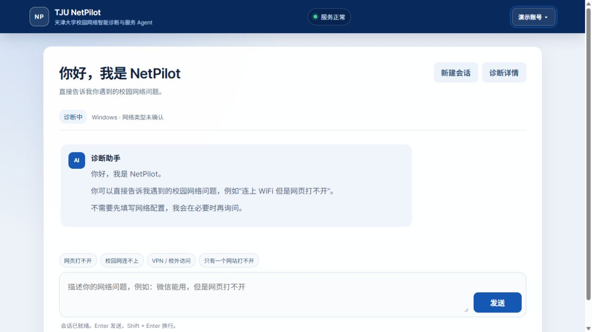

# TJU NetPilot

**面向天津大学师生的校园网络自助诊断与用网助手。** 用中文描述“校园 Wi‑Fi 连上了但网页打不开”之类的现象，NetPilot 会按需确认接入环境和受影响范围，结合当前设备证据给出排查步骤。用户可以在操作后复核，也可以把现象、检测结果和已尝试的操作整理为报修材料，自行交接给校内支持人员。



[更多界面与演示截图](screenshots/README.md)

## 谁会使用它

| 用户 | 常见需求 | 校园应用价值 |
| --- | --- | --- |
| 新生和在校学生 | 初次连接校园网，遇到宿舍 Wi‑Fi 断连、网页打不开、只有某个应用异常 | 从日常用语开始排查，按步骤确认影响范围与连接状态，减少盲目重置网络配置 |
| 教职工和科研团队 | 在校外访问校内资源，查询校园 VPN 或 eduroam，用教学和科研平台时发现连接异常 | 快速找到带来源的使用说明，结合诊断证据判断下一步应检查接入、解析、端口还是应用 |
| 校园网络支持人员 | 接收师生转交的故障信息，了解故障影响、已经尝试的步骤和处理效果 | 使用结构化报修材料开展初步分诊，减少重复询问和重复检测 |

## 核心功能

1. **用现象发起诊断。** 从“微信能用，但网页打不开”或“网页正常，SSH 连不上”开始，按需补充系统、接入方式、VPN / 代理和影响范围。诊断详情可查看当前对象、结论依据及未覆盖的检查项。
2. **按设备取证。** 运行服务的主机支持网卡与网关信息、Ping、DNS、TCP、HTTP 和路由跟踪等只读检查。远程 Windows 用户可下载工具，在故障设备上手动运行，再选择上传 JSON 快照。其他远程终端可根据现象和已知环境获得有限的排查建议。
3. **手动修复与前后复核。** 提供适用条件明确的低风险步骤，由用户自行执行并记录结果。系统比较修复前后的可比指标，并请用户确认原始症状；关键异常指标恢复且用户确认后，才标记为已解决。
4. **校园用网知识问答。** 覆盖校园网接入、VPN、eduroam、IPv6 等主题。答案附行内引用，来源区分校方材料与社区资料；具体办理和配置要求以所引来源的适用范围与时效为准。
5. **个人历史与报修交接。** 登录后可回看自己的会话、证据和处理记录，预览或导出 Markdown / JSON 报告。问题需要人工支持时，可另外生成脱敏报修材料，供用户自行发送。

NetPilot 定位于校园用户侧的自助初诊与人工分诊辅助。工具只读，修复步骤由用户执行，报修材料由用户交接。服务的可观测范围以运行主机、用户上传的快照或明确标记的模拟数据为限。

## 系统概览

中文 Web 界面通过同源 FastAPI 调用服务。单 Agent 使用天津大学 `tju-llm` 和原生 Function Calling，由服务端根据意图、诊断对象、证据覆盖和工具白名单控制诊断。网络工具共用 Mock / Local 接口，校园资料由 FastEmbed 中文向量模型和 FAISS 本地检索，SQLite 支撑认证和个人历史。Web 使用原生 JavaScript 和本地静态资源，运行时无需 Node.js。

架构图、诊断及复核流程、HTTP / SSE 接口和实现位置见 [DESIGN.md](DESIGN.md)。

## 本地启动

需要 Python 3.10+。在仓库根目录创建虚拟环境并安装项目。

```text
python -m venv .venv
```

**Windows PowerShell**

```powershell
.\.venv\Scripts\Activate.ps1
python -m pip install -e .
if (-not (Test-Path .env)) { Copy-Item .env.example .env }
```

**Linux / macOS**

```bash
source .venv/bin/activate
python -m pip install -e .
test -f .env || cp .env.example .env
```

普通聊天需要在服务端的私有 `.env` 中填写比赛平台分配的 Key 和专属 SDK 基础地址。基础地址填写到项目路径，SDK 会追加 `/chat/completions`。将 `.env` 留在本机，避免在前端、截图和日志中暴露凭据。

```dotenv
TJU_API_KEY=你的比赛_API_Key
TJU_API_BASE=比赛平台分配的专属_SDK_基础地址
TJU_MODEL=tju-llm
TOOL_MODE=mock
```

也可用 `LLM_PROVIDER`、`LLM_API_KEY`、`LLM_API_BASE`、`LLM_MODEL` 连接 DeepSeek 或其他 OpenAI-compatible Chat Completions 服务。配置方式、知识回答的引用回退和日志排查见 [模型服务兼容与知识回答验证](docs/llm-provider-compatibility.md)。

```bash
python -m uvicorn netpilot.main:app --host 127.0.0.1 --port 8000
```

打开 [NetPilot 首页](http://127.0.0.1:8000/)，注册并登录。可通过 [健康检查](http://127.0.0.1:8000/api/health) 查看模型配置、工具模式、知识索引和历史存储是否就绪。`llm_configured` 反映配置是否存在；真实模型联通性可通过 `python scripts/test_tju_api.py` 单独验证。缺少 Key 时仍可启动并运行下述快照演示。跨设备使用见 [局域网启动说明](docs/lan-demo.md)。

## 演示与验证

### 无 Key 演示完整诊断

在独立的 Windows PowerShell 终端激活环境并启动演示实例，使用单独的 SQLite 文件保存演示账号和历史。

```powershell
$env:DEMO_MODE = "true"
$env:TOOL_MODE = "mock"
$env:SCENARIO_SWITCH_ENABLED = "false"
$env:RAG_ENABLED = "false"
$env:DIAGNOSIS_HISTORY_ENABLED = "true"
$env:DIAGNOSIS_DB_PATH = ".cache/competition-demo.db"
python -m uvicorn netpilot.main:app --host 127.0.0.1 --port 8001
```

登录 [演示实例](http://127.0.0.1:8001/)，打开“诊断详情 → 演示 / 开发 → 演示模式 · Demo / Mock”。可选择以下两条路线。

| 场景 | 操作与预期 |
| --- | --- |
| DNS 恢复 | 加载修复前快照 → 记录完成手动步骤 → 加载修复后快照 → 确认原始症状已恢复。查看指标改善和“问题已解决”。 |
| DNS 多轮无改善 | 完成两轮低风险步骤与复核。有效复核持续无改善且安全步骤耗尽后，查看人工支持建议并生成报修材料。 |

演示快照、历史和导出均带有模拟数据标识。查看 [DNS 恢复截图](screenshots/demo-dns-recovery.jpg)、[报修交接截图](screenshots/demo-escalation.jpg) 或 [完整演示手册](docs/DEMO_SCENARIOS.md)。

### 测试工具调用与实机诊断

- **Mock 工具。** 已配置 Key 时，设置 `TOOL_MODE=mock` 和 `MOCK_SCENARIO=dns_failure` 后重启，输入“检查 `www.tju.edu.cn`：公网 IP 可达，但域名打不开”，观察 DNS 和连通性证据。也可用 `tcp_ssh_blocked` 测试 TCP 22 单端口故障。六个内置场景为 `healthy`、`dns_failure`、`gateway_unreachable`、`tcp_ssh_blocked`、`http_failure`、`partial_connectivity`。
- **Local 工具。** 设置 `TOOL_MODE=local` 后重启，在“诊断详情”中将诊断对象切换为“NetPilot 服务主机”，再请求检查主机 DNS 或指定服务的连通性。结果对应服务进程所在主机的网络视角。
- **远程 Windows 检查。** 在 Local 实例选中“当前浏览器设备”，描述故障。出现“开始网络检查”后，按页面引导下载、解压并确认脚本，在故障电脑上用普通用户运行，再手动上传结果。文件只代表采集时点的状态，修改网络后需重新采集。

### 构建校园知识索引

```bash
python scripts/build_knowledge_index.py
# 已有向量模型缓存时可离线重建
python scripts/build_knowledge_index.py --offline
```

脚本读取 `knowledge/raw/` 下带 YAML 来源信息的 UTF‑8 文档，默认将索引写入 `knowledge/index/`。首次构建可能下载向量模型。设置 `RAG_ENABLED=true` 并重启，确认 `rag_ready=true` 后可试问“天津大学 VPN 怎么使用？”模型持续限流时，知识回答可展示带引用的检索片段并注明整理状态。索引缺失时，网络诊断可继续使用。配置项见 [.env.example](.env.example)，限流行为见 [TJU 模型排查](docs/tju-llm-troubleshooting.md)。

### 自动测试

```bash
python -m pytest -q
python scripts/run_demo_scenarios.py
```

测试使用模拟模型、Mock Provider、临时数据库或受控替身。需要运行完整的前端 DOM 回归时，先准备 Node.js 22.13+（22.x）或 24+，安装测试依赖后再运行 Python 全量测试和前端测试。

```bash
npm ci --prefix web --ignore-scripts
npm test --prefix web
```

测试入口与现场验收步骤见 [测试与验收](docs/test-cases.md)。

## 上游与许可

正式应用位于 `src/netpilot/`，界面、校园知识和复现脚本分别位于 `web/`、`knowledge/` 和 `scripts/`。感谢 Sif Baksh 与 Packt 的 *Building AI Agents for Network Operations*。仓库保留其教学 Labs、Containerlab 示例和设计模板，并在此基础上开发 NetPilot。复用说明与 MIT 版权声明见 [上游来源](docs/upstream.md) 和 [LICENSE](LICENSE)。
